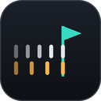
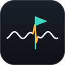

  

**Free professional audio software and music production tools, created for the global audio and creative community.** Each tool began as an answer to a need in real recording sessions and productions. All of them run on Windows, macOS (Apple silicon) and Linux, with no account, no license key and no data collected.

| | Tool | What it does | Download |
|---|---|---|---|
|  | **[CPX](https://github.com/isodalab/cpx)** Click Polytempo eXtended | Click tracks with a tempo of their own, one per player, meeting exactly on shared sync points. VST3 · AU · LV2 | [Latest release](https://github.com/isodalab/cpx/releases/latest) |
|  | **[AGM](https://github.com/isodalab/agm)** Audio Glitch Monitor | Flags digital glitches the moment they happen while you record. VST3 · AU · LV2 | [Latest release](https://github.com/isodalab/agm/releases/latest) |
|  | **[MCA](https://github.com/isodalab/mca)** Mono Compatibility Analyzer | Hear and measure your mix in mono, right on the master bus. VST3 · AU · LV2 | [Latest release](https://github.com/isodalab/mca/releases/latest) |
|  | **[ESTAVION](https://github.com/isodalab/estavion)** Mastering QC & Metadata | Checks and documents every file before delivery: noise, loudness, true peak, phase, metadata, QC reports. Standalone app | [Latest release](https://github.com/isodalab/estavion/releases/latest) |

Developed by **Dr. Hideki Isoda** at **Texas Tech University**. More at **[hidekiisoda.com/isodalab](https://hidekiisoda.com/isodalab/)**.

Freeware: free for personal, educational and commercial use. © 2026 Dr. Hideki Isoda / All Rights Reserved.
