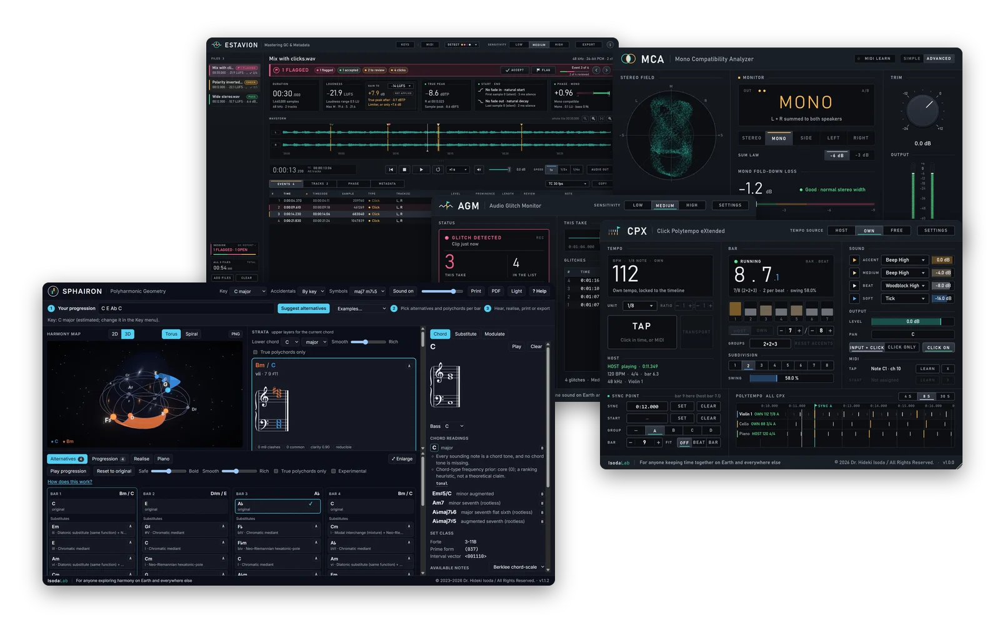
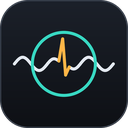

  

**Advanced music production tools, shared freely with the global creative community.**

SPHAIRON, CPX, AGM, MCA and ESTAVION are developed by Professor Hideki Isoda, composer and music technologist at the Texas Tech University School of Music as part of his academic community service. Each tool grew out of practical needs in his own compositional and recording work and has been refined through his teaching and research in music informatics.

They are offered free of charge, with no account, no license key and no data collected. All of them run on Windows, macOS (Apple silicon) and Linux.

| | Tool | What it does | Download |
|---|---|---|---|
|  | **[SPHAIRON](https://github.com/isodalab/sphairon)** Polyharmonic Geometry | Suggests substitutes and polychords for every chord of a progression, part-writes it for voices, orchestra and piano, and shows it in 3D harmonic geometry. Standalone app | [Latest release](https://github.com/isodalab/sphairon/releases/latest) |
|  | **[CPX](https://github.com/isodalab/cpx)** Click Polytempo eXtended | Click tracks with a tempo of their own, one per player, meeting exactly on shared sync points. VST3 · AU · LV2 | [Latest release](https://github.com/isodalab/cpx/releases/latest) |
|  | **[AGM](https://github.com/isodalab/agm)** Audio Glitch Monitor | Flags digital glitches the moment they happen while you record. VST3 · AU · LV2 | [Latest release](https://github.com/isodalab/agm/releases/latest) |
|  | **[MCA](https://github.com/isodalab/mca)** Mono Compatibility Analyzer | Hear and measure your mix in mono, right on the master bus. VST3 · AU · LV2 | [Latest release](https://github.com/isodalab/mca/releases/latest) |
|  | **[ESTAVION](https://github.com/isodalab/estavion)** Mastering QC & Metadata | Checks and documents every file before delivery: noise, loudness, true peak, phase, metadata, QC reports. Standalone app | [Latest release](https://github.com/isodalab/estavion/releases/latest) |

Developed by **Dr. Hideki Isoda** at **Texas Tech University**. More at **[hidekiisoda.com/isodalab](https://hidekiisoda.com/isodalab/)**.

Freeware: free for personal, educational and commercial use. © 2026 Dr. Hideki Isoda / All Rights Reserved.
